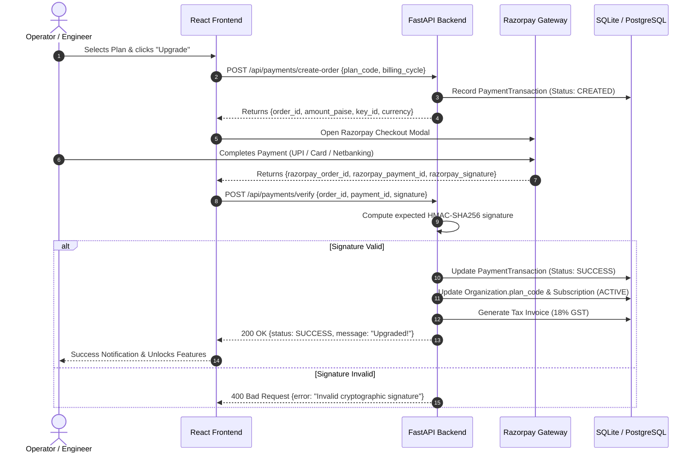

# Razorpay Payment Gateway Integration Guide

## 1. Overview
FALCONZ integrates **Razorpay** as the primary payment gateway for Indian commercial SaaS customers, supporting UPI, Debit/Credit Cards, and Net Banking.

---

## 2. Security Architecture

1. **Zero Secret Exposure**:
   - `RAZORPAY_KEY_SECRET` and `RAZORPAY_WEBHOOK_SECRET` reside strictly on the backend.
   - Frontend only receives the public `RAZORPAY_KEY_ID`.
2. **Server-Side Verification**:
   - Upgrades are never granted based solely on frontend callbacks.
   - The backend validates the cryptographic HMAC-SHA256 signature:
     $$\text{signature} = \text{HMAC-SHA256}(\text{order\_id} + "|" + \text{payment\_id}, \text{RAZORPAY\_KEY\_SECRET})$$
3. **Idempotent Webhooks**:
   - All inbound events are logged in `payment_webhook_events`.
   - Repeated deliveries of the same `event_id` are rejected gracefully without double-crediting.

---

## 3. Configuration & Environment Variables

```bash
# In backend/.env or system environment
RAZORPAY_KEY_ID="rzp_test_falconz_2026"
RAZORPAY_KEY_SECRET="falconz_secret_mock_test_key_123"
RAZORPAY_WEBHOOK_SECRET="falconz_webhook_secret_key_456"
```

---

## 4. Payment Flow



---

## 5. Webhook Handling
- **Endpoint**: `POST /api/payments/webhook`
- **Header**: `x-razorpay-signature`
- **Supported Events**:
  - `payment.captured` $\to$ Marks transaction as `SUCCESS`.
  - `payment.failed` $\to$ Logs error code and failure description.
  - `subscription.cancelled` $\to$ Marks active subscription as `CANCELLED`.

